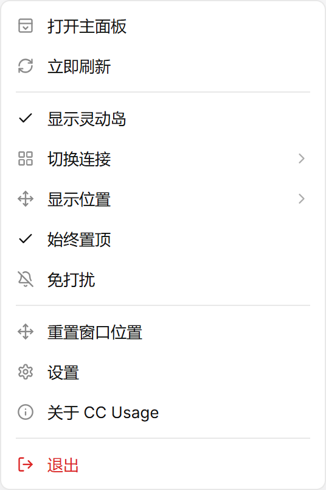

<div align="center">

# Jolu

**All your AI coding tools, managed in one place.**

A desktop island that stays on screen, plus a seven-module main window: connect providers, track usage, browse sessions, schedule automations and manage Skills — all on your own machine.

[](https://github.com/haishishushu/Jolu/releases/latest)


[Download](https://github.com/haishishushu/Jolu/releases/latest) · [Report an issue](https://github.com/haishishushu/Jolu/issues)

[简体中文](./README.md) | English


</div>

> Screenshots come from the frontend preview. Accounts, projects and numbers in them are examples, not your real usage. Actual data depends on local records, connection authorization and what each provider returns.


## Contents

- [Features](#features)
- [Supported platforms and quotas](#supported-platforms-and-quotas)
- [Download and install](#download-and-install)
- [Getting started](#getting-started)
- [Using each module](#using-each-module)
- [Understanding the numbers](#understanding-the-numbers)
- [Updates and data retention](#updates-and-data-retention)
- [Privacy and local storage](#privacy-and-local-storage)
- [FAQ](#faq)
- [Development](#development)
- [Feedback and license](#feedback-and-license)
- [Community](#community)
- [Star History](#star-history)

## Features

| Module | What it does |
| --- | --- |
| Island | Shows the current connection's quota, reset time and session deltas on your desktop; stays on top, docks to screen edges and supports up to 8 clones |
| Providers | Connect Claude Code, Codex, Gemini, Grok and more; manage accounts and see subscription quotas and API key usage |
| Usage | Overview, analysis and call details; filter by time, provider, account and model, and export calls to CSV |
| Sessions | Browse local sessions by project, search titles, session IDs or message text, read messages and continue in the original tool |
| Automation | Let Claude Code / Codex run tasks now, on a schedule or once quota recovers; progress is kept when quota runs out and resumed later |
| Skills | Scan, view, create, import, copy and enable/disable Claude Code and Codex Skills, with a backup before every write |
| Settings | Launch at login, theme, local CLI proxy, data import/export and cleanup, notifications and do-not-disturb |

Local statistics and online quotas are independent: **having local sessions does not mean the account quota can be queried, and having a quota does not mean sessions were recorded locally.**

## Supported platforms and quotas

### AI tools

| Platform | Main capabilities | Limits |
| --- | --- | --- |
| Claude Code | Local sessions and messages, tokens and cost estimates, official subscription and supported gateway quotas, continue in tool, automation, Skills | Quotas need valid authorization; API key connections through the local proxy can be attributed per connection |
| Codex | Local sessions and messages, tokens and cost estimates, official subscription and supported gateway quotas, continue in tool, automation, Skills | Usage outside the local proxy is merged per platform; OAuth is not attributed per connection |
| Gemini | Gemini CLI local sessions and token deltas (including thinking and tool tokens), cost estimates at official prices | Online remaining quota not connected; costs are estimates at API list prices |
| Grok | Remaining SuperGrok subscription percentage for the local OAuth login | No local session statistics |
| ZCode | Local usage records, token deltas, session done / failed / running states, BigModel Coding Plan key quotas | Account OAuth quota not connected |
| Qoder | Local records for the China and international editions, recorded credits | Online remaining credits not connected |
| WorkBuddy | Local usage, cache and reported credits | Consumed credits are not remaining credits |
| Trae | Local source detection | No local session statistics |

Custom providers support explicit URLs, protocols and API keys. ZCode and OpenCode connection flows are implemented; live ZCode key and OpenCode login validation remain pending; local OpenCode usage collection has been verified on this machine. Qoder and WorkBuddy keys stay managed in their original clients. Capabilities follow what the app actually shows; never infer login, balance, Skills or automation support from an icon or plan name.

### Quota providers

A platform is the tool you use; a quota provider is who supplies the quota. For example, if you use a Kimi coding plan inside Claude Code, the platform is still Claude Code.

| Provider | Detection | Shown |
| --- | --- | --- |
| Claude / Codex official subscription | Reads the CLI's local login credentials | Subscription windows and reset times returned by the service |
| Zhipu GLM / Z.ai | Detects the China or international edition from the base URL | Personal plan window usage |
| Kimi | Detects the Coding base URL | 5-hour and weekly windows |
| MiniMax | Detects the China or international base URL | 5-hour window and the weekly window when returned |
| ZenMux | Queries supported base URLs | Quota windows and amounts provided by the API |
| OpenCode Go | Detects the Go base URL | Rolling, weekly and monthly windows |
| Grok | Uses the local OAuth login | Remaining SuperGrok subscription percentage |

Volcengine Ark plan quotas require a control-plane AccessKey. Jolu does not store such high-privilege credentials, so they show as "not supported". Actual windows depend on your plan and what the API returns; unknown, unsupported or failed queries are shown as such and do not mean "zero remaining".

## Download and install

Download `Windows-x86_64-Setup.exe` from [GitHub Releases](https://github.com/haishishushu/Jolu/releases), run the installer and launch Jolu. Windows 10 / 11 x64 is supported.

- Every version has its own release page; download older versions from their own pages.
- The installer creates a Start menu entry and can create a desktop shortcut; uninstalling keeps app data by default.

## Getting started

### 1. Launch

A startup screen appears first and the main window opens as soon as local data is ready, with no artificial delay. The island appears at the top of the screen and can be dragged or docked. Clicking the shortcut again brings back the running instance instead of starting a second one.

### 2. Prepare data sources

Sign in to or configure the AI tools you want to use and run at least one session. Jolu reads existing local records; it never invents usage data.

### 3. Connect tools on the Providers page


1. Open **Providers → Provider connections** in the main window.
2. Click connect on a tool's card and follow the prompts to read the local login or enter an API key.
3. Switch to **Accounts** to see connected accounts, subscription quotas and connection status.

### 4. Choose what the island shows


Under **Connections and clones**, pick the connection for the main island, or open clones to show different accounts. The choice is saved locally. If the connection is removed or its credentials expire, choose again — Jolu never silently switches to another account on the same platform.

### 5. Confirm on the Usage page

Make one more request in your AI tool, then open **Usage → Overview** to see today's numbers. If nothing shows up, check the time and provider filters first, then see the [FAQ](#faq).

## Using each module

### Usage: from totals to single calls

- **Overview**: total tokens, calls, estimated cost and input cache hit rate; the trend for today or the chosen range; the top 5 models; usage per provider and the most expensive sessions.
- **Analysis**: a year-long activity calendar, today's active time and active days this week and month.
- **Calls**: model, tokens, latency and status per call; filter by status and keyword, and export to CSV.
- Click a period on the trend or a model to jump to the matching calls; click a session to open it in Sessions.

Latency, time to first token and status codes are shown only when the source provides them; missing fields do not mean a request failed.

### Sessions: read and resume local sessions


- Sessions are grouped by project on the left; filter by provider, account, project and time, and sort by most recent or most tokens.
- Search titles, session IDs or message text (press Enter).
- Read messages and tool calls on the right; "Session info" shows the project directory, models, tokens and estimated cost.
- **Continue in tool** checks that Claude Code / Codex is installed and the project directory is reachable, then resumes the session in a new console.
- **View usage** opens this session's calls; **Create automation** carries the session and project into a new task. Session compaction supports incremental summaries, refinement and Markdown handoff. Exploratory short-session evaluation is complete; long-session quality still requires suitable samples.

### Automation: keep AI working while you are away


- When creating a task, choose the tool (Claude Code / Codex), account, model, project directory and session, then describe the work.
- Start modes: **Run now**, **Scheduled** (once / daily / weekly) and **After quota recovers**.
- If quota runs out mid-run, progress is kept and the task waits, then resumes in the same session; if it cannot resume safely it is marked for manual follow-up instead of starting over.
- Tasks for the same account run one after another; run records track execution time and waiting time separately.
- The account must be the one currently signed in to the tool — Jolu does not switch logins for you, and file permissions follow the tool's own configuration.
- Jolu must keep running in the background; nothing is scheduled while the computer sleeps, and missed schedules are marked "missed" so you can decide whether to run them.

### Skills: manage every tool's Skills in one place


- Scans the global and project directories of Claude Code and Codex; projects are picked up from session records automatically and can also be added by hand.
- Browse files with Markdown preview; create, edit or import a Skill, or copy it to another tool.
- Enabling or disabling affects only that copy, never other copies with the same name; every write, overwrite or removal is backed up first.
- Gemini, OpenCode, Qoder, Trae and ZCode directories are supported. WorkBuddy uses `.codebuddy/skills` in read-only mode; custom scan directories are also read-only. HTTPS Git import and draft-to-disk diffs are supported. Gemini/OpenCode toggles are name-based, unlike Claude/Codex per-copy toggles.

### Settings


General (launch at login, silent start, auto refresh), Appearance (light / dark / system), Network and proxy (local CLI proxy), Data and storage (import/export, retention, cleanup, open data folder), Notifications (do-not-disturb, balance alerts) and About.

### Island and tray

| Collapsed | Expanded |
| --- | --- |
|  |  |
| Key quota and activity at a glance | Connection, session details and supported local deltas |

- **Double-click** to expand or collapse; **drag to a screen edge** to dock.
- **Right-click** for the menu: switch connection, position, always on top, and open / destroy clones. At least one island always remains.
- The dot on the tray icon shows the current connection's quota: green normal, yellow near the limit, red exhausted, grey unknown.
- Left-click the tray icon to open the main window. Closing the main window keeps collection, the island and automation scheduling running; quit from the tray menu.



## Understanding the numbers

| Metric | Meaning |
| --- | --- |
| Local tokens | From local session records, aggregated per platform; not a per-account or per-key bill |
| Fresh input | Input excluding recognizable cache reads, to see new input consumption |
| Cache read / write | Reuse of existing cache and cache creation; fields vary by source |
| Island delta | Fresh token deltas from supported sources; a different measure from totals that include cache reads |
| Subscription quota | Account or plan windows returned by the provider, possibly including usage from other devices |
| Estimated cost | Estimated from recognized models and price lists; not a final bill and not a subscription charge |
| Credits | Consumed credits reported by the source; not remaining credits unless stated |
| `—` / not supported / query failed | Read each as its own state; never treat them as zero |

Local tokens, island deltas and official quotas therefore do not have to match. Cross-device use, missing history, cache accounting and provider refresh delays can all cause differences.

## Updates and data retention

In-app update checks are not available yet. To upgrade, download the new installer from [GitHub Releases](https://github.com/haishishushu/Jolu/releases) and install over the existing version.

Settings and statistics live in the app data folder, which an in-place install keeps using. Island connections, display preferences, the main window position, automation tasks and run records all persist.

**Statistics export is not a full backup:**

- **Import / export** in Settings covers statistics records and session titles, with de-duplication on import; connections and credentials are not included.
- For a full backup, open the data folder from Settings, quit the app from the tray, then copy the whole folder.
- The full folder may contain credentials; keep it somewhere trusted. After restoring on another device you may still need to sign in to the original tools again.

See [versioning rules](./docs/release-versioning.md) for how releases are numbered.

## Privacy and local storage

```text
Local session files ──incremental read, de-dup──→ Local SQLite ──→ Main window / island
Provider APIs       ──query quota with the current connection──→ Quota windows
Automation tasks    ──run claude / codex locally──────────────→ Run records
```

- Statistics are stored in the local SQLite database `usage.db`; preferences in `settings.json`. The default Windows data folder is `%APPDATA%\dev.ningz.jolu`, which you can open from Settings.
- Quota checks, credential refresh and model queries contact the corresponding services and send authorization as required by their APIs; "local storage" does not mean "never online".
- Automation runs the original tools on your machine and never goes through a Jolu server; writing Skills changes the tool's folders and configuration, with a backup in the app data folder first.
- If you enable the local proxy, model requests are forwarded through it to the configured upstream, and the related CLI configuration changes.
- API keys are handled only by the backend and shown masked in lists; never share the full data folder or credential files.

## FAQ

<details>
<summary>No statistics after installing?</summary>

Make sure the AI tool has produced local sessions and that the Usage page uses the right time range and provider. An online account without local records will not backfill cross-device history. Platforms without local session support, such as Trae, do not show full token statistics.

</details>

<details>
<summary>Why are there tokens but no subscription quota?</summary>

Local statistics and online quotas are independent. Check whether the platform supports quota queries, whether the authorization is valid and whether the base URL is recognized. A working API key does not grant subscription quota access.

</details>

<details>
<summary>Why didn't my automation task run?</summary>

Check the task status: if the account is not the one signed in to the tool, the run stops at "needs attention"; without quota it waits for recovery; nothing is scheduled while Jolu is fully quit or the computer sleeps. Also make sure the tool is installed and the project directory is reachable.

</details>

<details>
<summary>"Continue in tool" doesn't open?</summary>

Only Claude Code and Codex are supported. The dialog checks that the tool is installed and the project directory still exists; if either check fails, copy the session ID and resume it manually in the tool.

</details>

<details>
<summary>Can't find the island or the main window?</summary>

Open the main window from the system tray and make sure the island is shown on the Island page. After changing monitors or resolution, use "Reset window position". On Windows the tray icon may be hidden in the overflow area.

</details>

<details>
<summary>Why does the browser preview show different data?</summary>

The browser preview uses example data and never reads your real credentials or statistics. Run the desktop app to see real usage.

</details>

## Development

Stack: **Tauri 2 · Rust · React 19 · TypeScript · Vite · Tailwind CSS 4 · SQLite**. The only UI source of truth is [`docs/ui/Jolu.pen`](./docs/ui/Jolu.pen); see [AGENTS.md](./AGENTS.md) for conventions.

From the repository root:

```bash
pnpm install
pnpm --dir frontend install

# Browser preview with example data
pnpm dev

# Desktop development with the Rust backend and local data
pnpm tauri dev

# Frontend type check and unit tests
pnpm --dir frontend typecheck
node --test frontend/src/lib/*.test.mjs

# Backend tests
cargo test --manifest-path backend/Cargo.toml

# Build a local Windows installer (NSIS, without signed updater artifacts)
pnpm tauri build --config '{"bundle":{"createUpdaterArtifacts":false}}'
```

The installer is written to `backend/target/release/bundle/nsis/`. The first Rust build takes a while; if the dev port conflicts, check that the Vite address matches Tauri's `devUrl`.

### Project structure

```text
jolu/
├─ frontend/          Multi-window React frontend and browser example data
│  └─ src/
│     ├─ views/       Main window modules, island, startup screen, tray entries
│     ├─ components/  automation, providers, sessions, settings, skills, usage and shared components
│     ├─ hooks/       Settings, connection, quota and query hooks
│     └─ lib/         API bridge, platform catalog and pure logic
├─ backend/           Rust / Tauri backend
│  └─ src/            Collection, database, connections, quotas, sessions, automation, Skills, windows and tray
├─ docs/              Design file, brand assets, screenshots and versioning rules
└─ scripts/           Icon generation, release versioning and acceptance scripts
```

The collector reads local records incrementally and de-duplicates them into SQLite; the quota module queries the service behind the current connection; the automation scheduler runs local tools in the background, queued per account. Platform capabilities are defined in the [platform catalog](./frontend/src/lib/platformCatalog.json).

## Feedback and license

- [Open an issue](https://github.com/haishishushu/Jolu/issues): include the version, OS, steps to reproduce, expected and actual results; hide credentials in screenshots and logs.
- [Releases](https://github.com/haishishushu/Jolu/releases) · [Roadmap](./docs/plans/2026-10-21-jolu-development-roadmap.md)
- The original repository description says MIT; a separate LICENSE file has not been added yet. Improvements with a clear problem description and verification notes are welcome.

## Community

[linux.do](https://linux.do/) - A thriving developer community.

## Star History

<a href="https://www.star-history.com/?repos=haishishushu%2FJolu&amp;type=date&amp;legend=top-left">
  <picture>
    <source media="(prefers-color-scheme: dark)" srcset="https://api.star-history.com/chart?repos=haishishushu/Jolu&amp;type=date&amp;legend=top-left&amp;theme=dark" />
    <source media="(prefers-color-scheme: light)" srcset="https://api.star-history.com/chart?repos=haishishushu/Jolu&amp;type=date&amp;legend=top-left" />
    
  </picture>
</a>


Session handoff supports incremental summaries, draft refinement and Markdown preview/export. Exploratory prompt evaluation covered five short sessions; it does not establish long-session quality. OpenCode JSON/SQLite V1/V2 usage parsing keeps unknown fields unknown and adds visible output and separate reasoning while preferring the source total. See [unverified integrations](docs/todo/2026-10-22-unverified-integrations.md). Update checks are on by default; set both `JOLU_UPDATES_ENABLED=0` and `VITE_JOLU_UPDATES_ENABLED=0` at build time to turn them off.
