<div align="center">

# Jolu

**把 AI 编程工具管在一处。**

额度常驻桌面灵动岛 · 每日福利一键签到 · 额度用完自动等待、恢复后续跑

[](https://github.com/haishishushu/Jolu/releases/latest)


[下载安装](https://github.com/haishishushu/Jolu/releases/latest) · [反馈问题](https://github.com/haishishushu/Jolu/issues)

简体中文 | [English](./README.en.md)

<picture>
  <source media="(prefers-color-scheme: dark)" srcset="./docs/assets/readme/island-collapsed-dark.png" />
  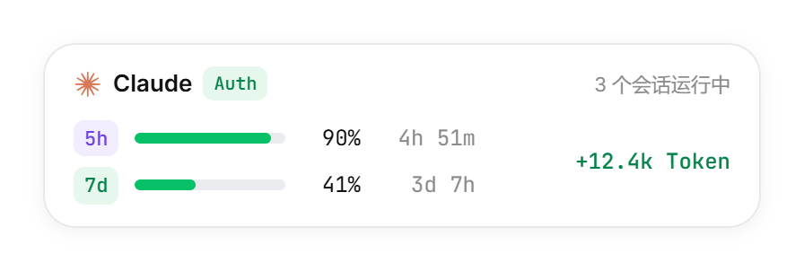
</picture>

</div>

> 文中的界面图片来自前端预览，图中的账号、项目和数值都是示例，不代表你的真实用量。实际数据取决于本机留存记录、连接授权和服务商返回结果。

## 三大亮点

### 灵动岛：额度和会话常驻桌面

不用切窗口、不用开网页，屏幕上方的灵动岛随时告诉你：当前账号还剩多少额度、什么时候重置、有几个会话正在跑、这一轮又用了多少 Token。

| 收缩态 | 展开态 |
| --- | --- |
| <picture><source media="(prefers-color-scheme: dark)" srcset="./docs/assets/readme/island-collapsed-dark.png" /></picture> | <picture><source media="(prefers-color-scheme: dark)" srcset="./docs/assets/readme/island-expanded-dark.png" />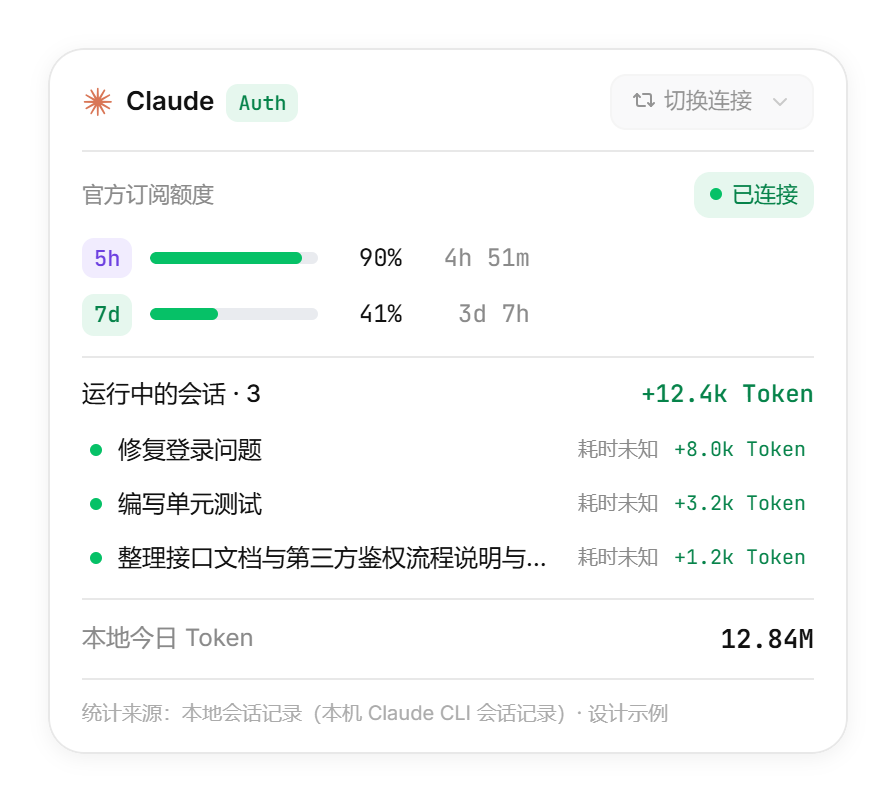</picture> |
| 5 小时 / 7 天额度、重置倒计时与会话增量 | 订阅额度、运行中的会话明细与本地今日 Token |

- **双击**展开或收起；**拖向屏幕边缘**自动吸附停靠，不挡视线。
- 最多开启 **8 个分身**，每个分身显示不同的账号或工具，多账号额度一眼看全。
- **右键菜单**可切换连接、调整显示位置、置顶、免打扰，以及开启或销毁分身；至少保留一个灵动岛。
- 系统托盘图标右下角的圆点同步显示额度状态：绿色正常、黄色接近上限、红色已耗尽、灰色未知。
- 左键单击托盘图标打开主窗口；关闭主窗口后，灵动岛、后台采集和自动化调度继续运行，完全退出请使用托盘菜单。

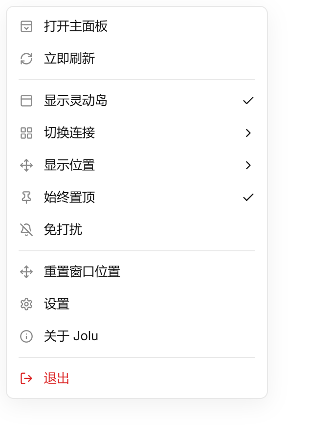

### 一键签到：每日福利一次领取

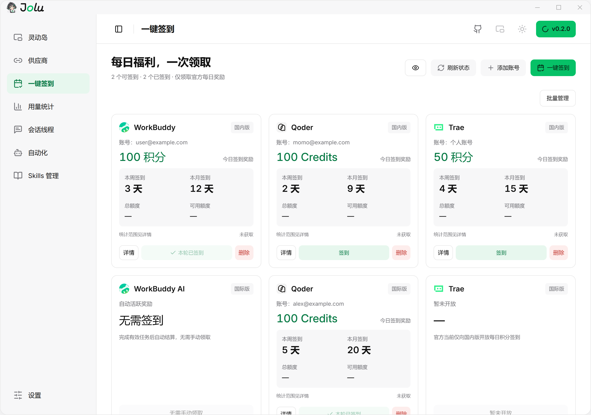

- 按 WorkBuddy、Qoder、Trae 的国内版与国际版分成六张卡片，每张卡片显示今日奖励、本周 / 本月签到天数和账号额度。
- 点 **一键签到** 依次领取全部可签到账号；也可以逐个签到，部分失败时单独重试，不会重复领取同一账号。
- 添加账号时先选供应商，按该供应商的流程授权；同一浏览器中可以添加多个账号，**批量管理** 支持批量删除。
- 签到记录与本期累计积分按来源区分官方记录与 Jolu 记录；点眼睛图标可一键隐藏账号，方便截图分享。
- 当前支持 WorkBuddy 国内版、Qoder 国内 / 国际版、Trae 国内版的手动签到；WorkBuddy AI 完成有效任务后自动结算，Trae 国际版官方暂未开放每日签到。

### 额度用完不中断：恢复后自动续跑

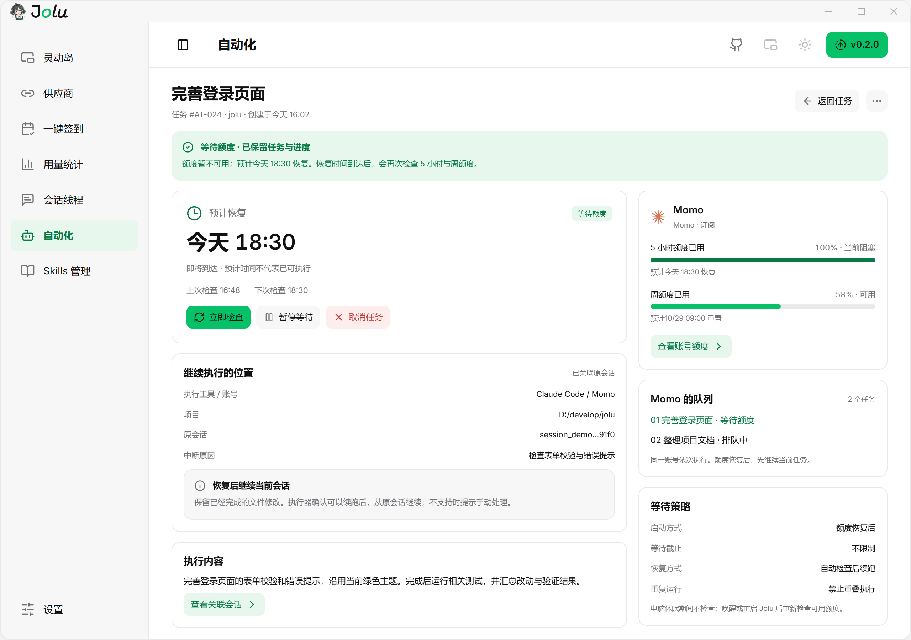

把任务交给 Claude Code 或 Codex，额度耗尽也不会白跑：

- **执行中额度耗尽**：保留已完成的文件修改和会话进度，任务进入「等待额度」，界面显示预计恢复时间和下次检查时间。
- **额度恢复后**：自动重新检查 5 小时与周额度，确认可用后在**原会话**里继续执行，不会从头重跑；无法安全续跑时标记为需要手动继续。
- **启动方式**：立即执行、定时执行（单次 / 每天 / 每周），或直接设为「额度恢复后执行」，把重活排到额度刷新的那一刻。
- **同账号排队**：同一账号的任务按队列依次执行；运行记录里分开统计执行耗时与等待时长。

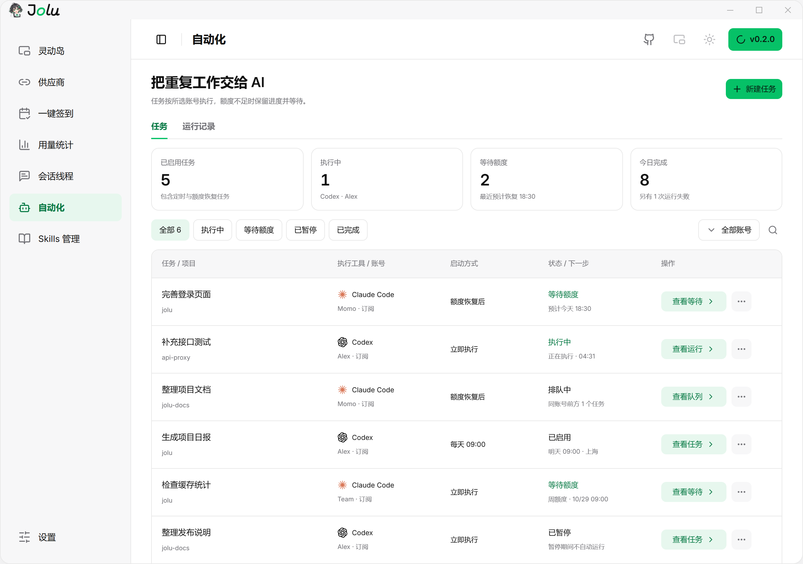

- 新建任务时选择执行工具、账号、模型、项目目录和执行会话，可以从会话线程一键带入会话和项目。
- 执行账号必须是原工具当前登录的账号，Jolu 不会替你切换登录；文件修改权限沿用工具自身的配置。
- 本地任务需要 Jolu 在后台运行；休眠与关机期间停止调度，错过的定时触发标为「已错过」，由你决定是否补跑。

## 目录

- [三大亮点](#三大亮点)
- [核心功能](#核心功能)
- [平台与额度支持](#平台与额度支持)
- [下载与安装](#下载与安装)
- [首次使用](#首次使用)
- [各模块怎么用](#各模块怎么用)
- [读懂统计数据](#读懂统计数据)
- [更新与数据保留](#更新与数据保留)
- [隐私与本地存储](#隐私与本地存储)
- [常见问题](#常见问题)
- [开发与构建](#开发与构建)
- [反馈与许可证](#反馈与许可证)
- [Community 社区](#community-社区)
- [Star History](#star-history)

## 核心功能

| 模块 | 可以做什么 |
| --- | --- |
| 灵动岛 | 常驻桌面查看当前连接的额度、重置时间和会话增量；可置顶、贴边停靠、开启最多 8 个分身 |
| 供应商 | 连接 Claude Code、Codex、Gemini、Grok 等工具；管理账号，查看订阅额度与 API Key 用量 |
| 一键签到 | 批量或逐个领取 WorkBuddy、Qoder、Trae 的官方每日奖励，查看签到记录与积分统计 |
| 用量统计 | 概览、用量分析、调用明细三个视图；按时间、供应商、账号、模型筛选，调用明细可导出 CSV |
| 会话线程 | 按项目浏览本机会话，搜索标题、会话 ID 或正文；只读查看消息，一键在原工具中继续 |
| 自动化 | 让 Claude Code / Codex 立即、定时或额度恢复后执行任务；额度耗尽时保留进度，恢复后续跑 |
| Skills 管理 | 扫描、查看、新建、导入、复制、启停 Claude Code 与 Codex 的 Skills，写入前自动备份 |
| 设置 | 开机启动、主题、CLI 本地代理、数据导入导出与清理、通知与免打扰 |

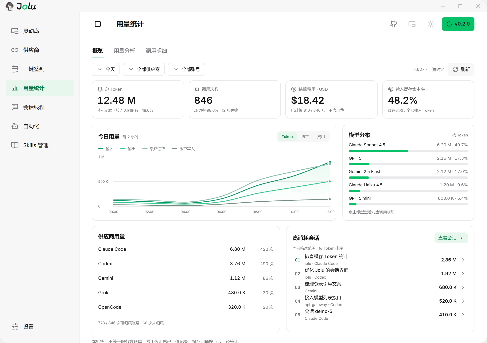

本地统计与在线额度是两条独立链路：**有本机会话不代表能查询账号额度；有账号额度也不代表本机留存了会话记录。**

## 平台与额度支持

### AI 工具平台

| 平台 | 已接入的主要能力 | 使用边界 |
| --- | --- | --- |
| Claude Code | 本机会话与消息、Token 与费用估算、官方订阅及支持网关的额度查询、在原工具中继续、自动化执行、Skills 管理 | 额度需要有效授权；经本地代理的 API Key 连接可按连接归账 |
| Codex | 本机会话与消息、Token 与费用估算、官方订阅及支持网关的额度查询、在原工具中继续、自动化执行、Skills 管理 | 未经本地代理的本机用量按平台合并；OAuth 不参与按连接归账 |
| Gemini | Gemini CLI 本机会话与 Token 增量（含思考、工具 Token）、按官方价目的费用估算 | 在线剩余额度未接入；费用为按 API 标价的估算 |
| Grok | 本机 OAuth 对应的 SuperGrok 订阅剩余百分比 | 未接入本机会话统计 |
| ZCode | 本机用量记录、Token 增量、会话完成 / 失败 / 运行中状态、BigModel Coding Plan Key 的套餐查询 | 账号 OAuth 额度未接入 |
| Qoder | 国内版与国际版本机记录、已记录积分 | 在线剩余积分未接入 |
| WorkBuddy | 本机用量、缓存与已上报积分 | 已消耗积分不等于剩余积分 |
| Trae | 本机来源检测入口 | 不支持本机会话统计 |

自定义供应商已支持显式填写地址、协议与 API Key；ZCode 与 OpenCode 已接入连接流程，ZCode 真实 Key 与 OpenCode 登录仍待验证，OpenCode 本机用量读取已完成真机验证。Qoder / WorkBuddy 的自定义模型在原客户端配置，Jolu 不代管密钥。平台能力以应用中的实际提示为准，不能根据图标或套餐名称推断某个平台支持登录、余额、Skills 或自动化。

### 额度服务商

平台表示“使用哪个工具”，服务商表示“由谁提供额度”。例如，在 Claude Code 中使用 Kimi 编程套餐，工具平台仍是 Claude Code。

| 服务商 | 识别方式 | 可显示内容 |
| --- | --- | --- |
| Claude / Codex 官方订阅 | 读取对应 CLI 的本机登录凭证 | 服务端返回的订阅窗口和重置时间 |
| 智谱 GLM / Z.ai | 按服务地址识别国内或国际版 | 个人版套餐窗口使用情况 |
| Kimi | 识别 Coding 服务地址 | 5 小时与周窗口 |
| MiniMax | 识别国内或国际服务地址 | 5 小时窗口，以及接口返回的周窗口 |
| ZenMux | 按支持的服务地址查询 | 额度窗口与接口提供的金额信息 |
| OpenCode Go | 识别 Go 服务地址 | 滚动、周、月窗口 |
| Grok | 使用对应的本机 OAuth 授权 | SuperGrok 订阅剩余百分比 |

火山方舟的套餐额度需要控制面 AccessKey，Jolu 不保存这类高权限凭证，因此显示为「不支持」。具体窗口以账户套餐和接口返回为准；未知、不支持或查询失败会显示相应状态，不应理解为“剩余为零”。

## 下载与安装

在 [GitHub Releases](https://github.com/haishishushu/Jolu/releases) 下载 `Windows-x86_64-Setup.exe`，运行安装向导，完成后启动 Jolu。支持 Windows 10 / 11 x64。

- 每个版本拥有独立发行页，历史版本应从对应版本页下载。
- 安装向导会创建开始菜单入口，并可创建桌面快捷方式；卸载默认保留应用数据。

## 首次使用

### 1. 启动应用

启动时先显示启动页，本地数据准备好后直接进入主窗口，不设人为等待。灵动岛同时出现在屏幕上方，可拖动或贴边停靠。多次点击快捷方式会唤起已有实例，不会重复运行。

### 2. 准备数据来源

先在需要使用的 AI 工具中完成登录或配置，并实际产生一次会话。Jolu 读取本机已有记录，不会凭空生成使用数据。

### 3. 在「供应商」页连接工具

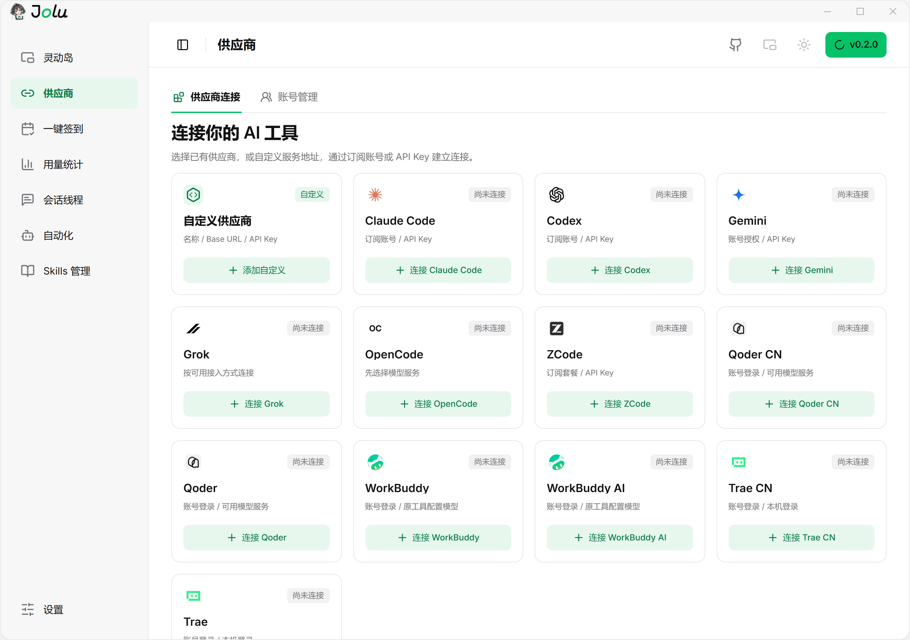

1. 打开主窗口的 **供应商 → 供应商连接**。
2. 在对应工具的卡片上点击连接，按提示读取本机登录或填写 API Key。
3. 切到 **账号管理** 查看已接入的账号、订阅额度和连接状态。

### 4. 在「灵动岛」页选择要显示的连接

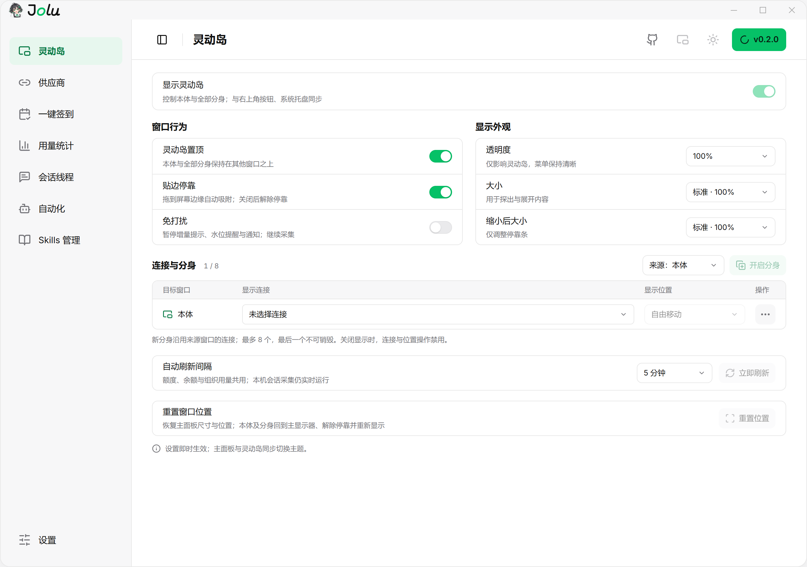

在 **连接与分身** 里为灵动岛本体选择连接，也可以开启分身分别显示不同账号。选择会保存在本地；原连接被删除或凭证失效时需要重新选择，应用不会悄悄换成同平台的其他账号。

### 5. 在「用量统计」确认数据生效

在 AI 工具中再完成一次请求，回到 **用量统计 → 概览** 查看今日数据。若没有数据，先检查时间与供应商筛选，再看[常见问题](#常见问题)。

## 各模块怎么用

灵动岛、一键签到和自动化的用法见[三大亮点](#三大亮点)。

### 用量统计：从总量到单次调用

- **概览**：总 Token、调用次数、估算费用、输入缓存命中率，今日或所选范围的趋势，前 5 个模型的分布，各供应商用量和高消耗会话。
- **用量分析**：一年的活跃日历、今日活跃时长和本周 / 本月活跃天数。
- **调用明细**：逐条查看模型、Token、耗时、状态，可按状态和关键词筛选，导出为 CSV。
- 点击趋势图的时间段或模型，可直接跳到对应的调用明细；点击会话可跳到会话线程。

请求耗时、首字时间、状态码等仅在数据来源提供时展示；缺失字段不代表请求失败。

### 会话线程：翻看与接续本机会话

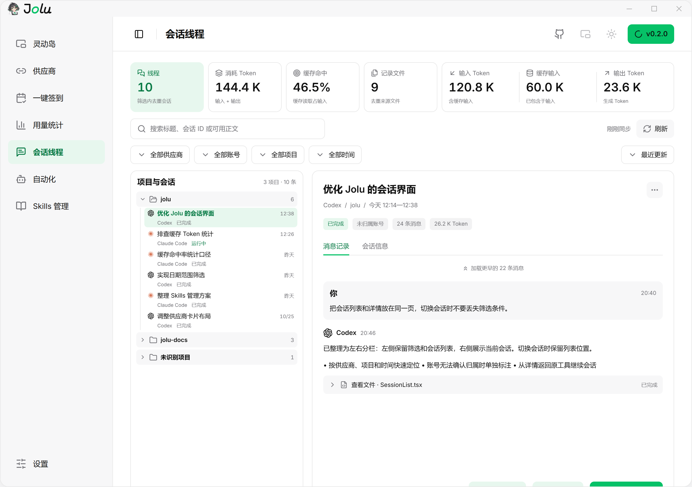

- 左侧按项目分组列出会话，支持按供应商、账号、项目、时间筛选，按最近更新或消耗排序。
- 搜索框可查标题、会话 ID 或正文（按 Enter 查询）。
- 右侧只读查看消息记录与工具调用，「会话信息」里有项目目录、模型、Token 与估算费用。
- **在原工具中继续**：检查 Claude Code / Codex 是否安装、项目目录是否可访问后，在新的控制台里续聊原会话。
- **查看用量明细**跳到这条会话的调用明细；**创建自动化**把会话和项目带进新建任务。**压缩会话**支持增量整理、对话式修改草稿及 Markdown 交接；已完成短会话探索性评测，长会话质量仍待合格样本验证。

### Skills 管理：一处管理各工具的 Skills

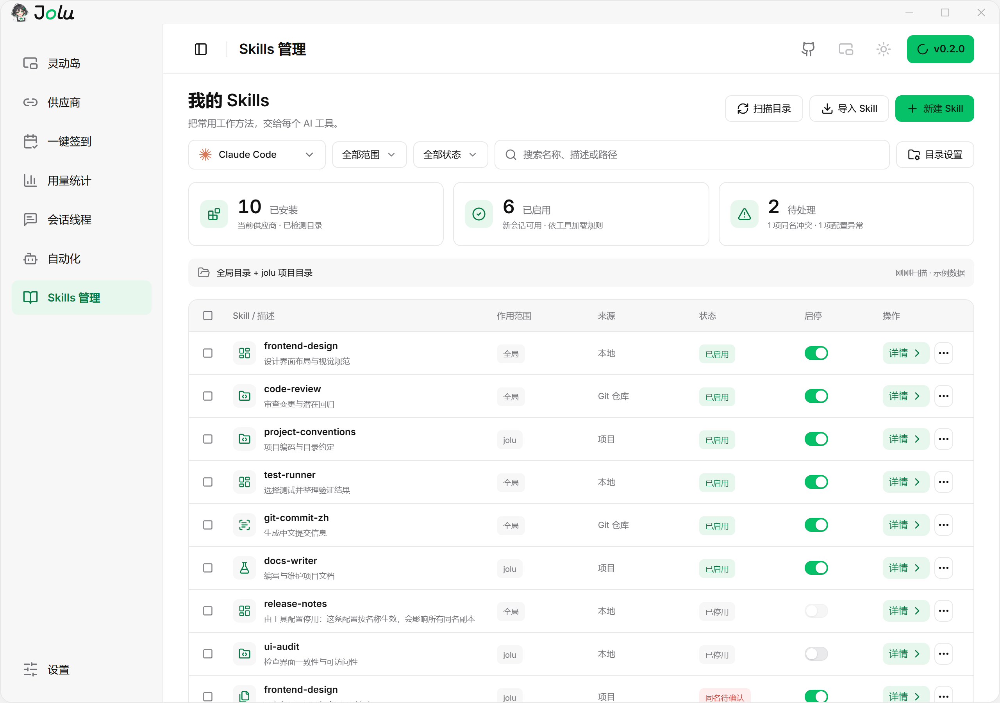

- 扫描 Claude Code、Codex、Gemini、OpenCode、Qoder、Trae、ZCode 的全局目录和项目目录；WorkBuddy 只读扫描 `.codebuddy/skills`，也可添加自定义只读目录；项目会从会话记录里自动带出，也可以手动添加。
- 查看文件树与 Markdown 预览，新建、编辑、导入 Skill，或复制到另一个工具。
- Claude Code / Codex 按副本启停；Gemini / OpenCode 按名称规则生效，会影响同名项。其余平台的启停状态需在原工具核对。写入、覆盖、移除前都会先备份。
- 支持 HTTPS Git 仓库导入及草稿与磁盘文件的逐行差异；Grok Skills 未接入，新接入工具的原客户端识别和热加载仍待真机核对。

### 设置

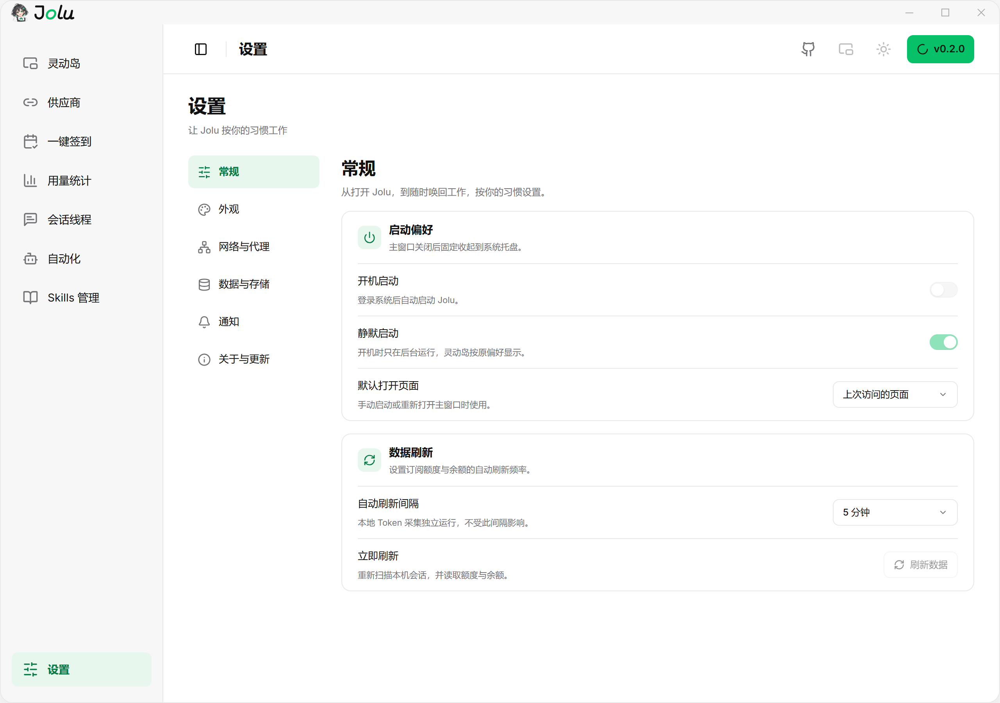

常规（开机启动、静默启动、自动刷新）、外观（浅色 / 深色 / 跟随系统）、网络与代理（CLI 本地代理）、数据与存储（导入导出、历史保留、清理、打开数据目录）、通知（免打扰、余额提醒）以及关于与更新。

## 读懂统计数据

| 指标 | 含义与注意事项 |
| --- | --- |
| 本地 Token | 来自本机留存的会话记录，按平台聚合，不能视为单个账号或 Key 的独立账单 |
| 新增输入 | 排除可识别的缓存重读部分，用来观察新输入的消耗 |
| 缓存读取 / 创建 | 分别反映复用已有缓存和创建缓存；不同来源提供的字段不同 |
| 灵动岛增量 | 反映支持来源的新鲜 Token 增量，与含缓存重读的总量口径不同 |
| 订阅额度 | 服务商返回的账号或套餐窗口，可能涵盖其他设备上的使用 |
| 估算费用 | 按可识别模型和价目估算；不是最终账单，不等同于订阅套餐扣款 |
| 积分 | 来源已上报的消耗积分；除非明确标注，否则不是账户剩余积分 |
| `—` / 不支持 / 查询失败 | 分别按界面状态理解；不能统一当作数值零 |

因此，本地 Token、灵动岛增量和官方额度无需完全一致。跨设备使用、历史记录缺失、缓存统计方式和服务商刷新延迟都可能造成差异。

## 更新与数据保留

应用默认启动时检查一次更新，之后每 30 分钟检查；发现新版本会在后台下载并校验签名，页头出现绿色版本按钮，点击后自动安装并重启。也可以从 [GitHub Releases](https://github.com/haishishushu/Jolu/releases) 下载新版安装包直接覆盖安装。

设置与统计保存在应用数据目录，覆盖安装会继续使用原目录。灵动岛连接、显示偏好、主窗口位置、自动化任务与运行记录都会持久化。

**统计导出与完整备份有区别：**

- 设置中的 **导入 / 导出** 用于统计记录和会话标题，导入会去重；不包含连接与凭证。
- 如需备份完整本机状态，先在设置中打开数据目录，再从托盘完全退出应用，复制整个目录。
- 完整目录可能包含凭证，只应保存在可信位置。跨设备恢复后仍可能需要在原工具中重新登录。

发行方式和版本递增规则见[版本号规则](./docs/release-versioning.md)。

## 隐私与本地存储

```text
本机会话文件 ──增量读取、去重──→ 本地 SQLite ──→ 主窗口 / 灵动岛
服务商接口   ──使用当前连接查询额度──────────→ 额度窗口
自动化任务   ──在本机调用 claude / codex──────→ 运行记录
```

- 统计记录保存在本机 SQLite 数据库 `usage.db`，运行偏好保存在 `settings.json`。Windows 默认应用目录为 `%APPDATA%\dev.ningz.jolu`，可在设置的数据区域打开。
- 额度检测、凭证刷新、模型查询等会访问对应服务，并按接口要求发送授权信息；不能将“本地存储”理解为“完全不联网”。
- 自动化任务在本机调用原工具执行，不经过 Jolu 的服务器；Skills 的写入会修改对应工具的目录与配置，修改前会备份到应用数据目录。
- 如主动启用本地代理，模型请求会经过本地代理转发至配置的上游，相关 CLI 配置也会改变。
- API Key 只在后端处理，界面列表以脱敏形式展示；不要公开完整数据目录或凭证文件。

## 常见问题

<details>
<summary>安装后没有统计数据怎么办？</summary>

确认目标 AI 工具已经产生本机会话，在用量统计里选择正确的时间范围与供应商。只有在线账号但没有本机记录时，不会自动补出跨设备历史。Trae 等未接入本机会话的平台也不会显示完整 Token 统计。

</details>

<details>
<summary>为什么有 Token，却没有订阅额度？</summary>

本机统计与在线额度独立。检查该平台是否支持额度查询、授权是否有效、服务地址能否识别。API Key 可用不代表拥有订阅额度查询权限。

</details>

<details>
<summary>自动化任务为什么没有执行？</summary>

先看任务状态：执行账号不是原工具当前登录的账号时，运行会停在「需要处理」；额度不足时会进入「等待额度」；Jolu 被完全退出或电脑休眠期间不会调度。也请确认原工具已安装、项目目录可访问。

</details>

<details>
<summary>在原工具中继续打不开怎么办？</summary>

目前只支持 Claude Code 与 Codex。弹窗会检查工具是否安装、项目目录是否还在；任一项未通过时，仍可复制会话 ID 后手动在原工具里恢复。

</details>

<details>
<summary>灵动岛或主窗口找不到了怎么办？</summary>

从系统托盘打开主窗口，在灵动岛页确认已显示灵动岛。若曾更换显示器或分辨率，使用重置窗口位置。Windows 托盘图标也可能被收纳到隐藏图标区域。

</details>

<details>
<summary>为什么浏览器预览的数据与桌面应用不同？</summary>

浏览器预览使用示例数据展示界面，不读取本机的真实凭证和统计。查看真实用量需要运行桌面版本。

</details>

## 开发与构建

技术栈：**Tauri 2 · Rust · React 19 · TypeScript · Vite · Tailwind CSS 4 · SQLite**。界面唯一设计依据是 [`docs/ui/Jolu.pen`](./docs/ui/Jolu.pen)，开发规范见 [AGENTS.md](./AGENTS.md)。

在仓库根目录执行：

```bash
pnpm install
pnpm --dir frontend install

# 浏览器界面预览，使用示例数据
pnpm dev

# 桌面开发，连接 Rust 后端和本机数据
pnpm tauri dev

# 前端类型检查与单元测试
pnpm --dir frontend typecheck
node --test frontend/src/lib/*.test.mjs

# 后端测试
cargo test --manifest-path backend/Cargo.toml

# 打包本地 Windows 安装包（NSIS，不生成正式更新签名产物）
pnpm tauri build --config '{"bundle":{"createUpdaterArtifacts":false}}'
```

安装包位于 `backend/target/release/bundle/nsis/`。首次 Rust 编译耗时较长；开发端口冲突时，检查 Vite 地址与 Tauri 的 `devUrl` 是否一致。

开发验证边界见 [未验证项清单](docs/todo/2026-10-22-unverified-integrations.md)。检查更新默认启用，构建时同时设置 `JOLU_UPDATES_ENABLED=0` 和 `VITE_JOLU_UPDATES_ENABLED=0` 可停用。OpenCode 统计支持 JSON / SQLite V1/V2；落盘 output 表示可见输出，Jolu 将其与独立 reasoning 相加；总量优先采用来源的 total，缺失字段保持未知。

### 项目结构

```text
jolu/
├─ frontend/          React 多窗口前端与浏览器示例数据
│  └─ src/
│     ├─ views/       主窗口各模块、灵动岛、启动页、托盘等入口
│     ├─ components/  automation、providers、sessions、settings、skills、usage 等功能区域与通用组件
│     ├─ hooks/       设置、连接、额度和查询 hooks
│     └─ lib/         API 桥接、平台目录与纯逻辑
├─ backend/           Rust / Tauri 后端
│  └─ src/            采集、数据库、连接、额度、会话、自动化、Skills、窗口与托盘
├─ docs/              设计稿、品牌素材、使用配图与版本规则
└─ scripts/           图标生成、发布版本计算与验收脚本
```

采集器增量读取本机记录并去重写入 SQLite；额度模块查询当前连接对应的服务；自动化调度器在后台按队列调用本机工具。平台能力定义见[平台目录](./frontend/src/lib/platformCatalog.json)。

## 反馈与许可证

- [提交问题或建议](https://github.com/haishishushu/Jolu/issues)：请提供版本、操作系统、复现步骤、预期与实际结果；截图和日志请隐藏凭证。
- [发行记录](https://github.com/haishishushu/Jolu/releases) · [路线图](./docs/plans/2026-10-21-jolu-development-roadmap.md)
- 仓库原说明标注为 MIT，独立的 LICENSE 文件尚未补充。欢迎提交有明确问题描述和验证说明的改进。

## Community 社区

[linux.do](https://linux.do/) - A thriving developer community.

## Star History

<a href="https://www.star-history.com/?repos=haishishushu%2FJolu&amp;type=date&amp;legend=top-left">
  <picture>
    <source media="(prefers-color-scheme: dark)" srcset="https://api.star-history.com/chart?repos=haishishushu/Jolu&amp;type=date&amp;legend=top-left&amp;theme=dark" />
    <source media="(prefers-color-scheme: light)" srcset="https://api.star-history.com/chart?repos=haishishushu/Jolu&amp;type=date&amp;legend=top-left" />
    
  </picture>
</a>
